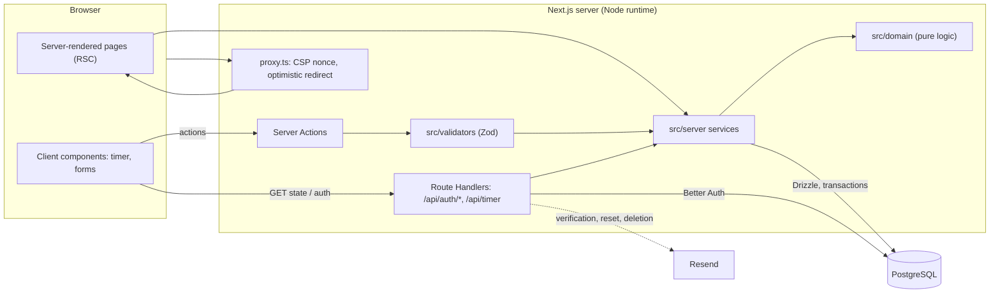
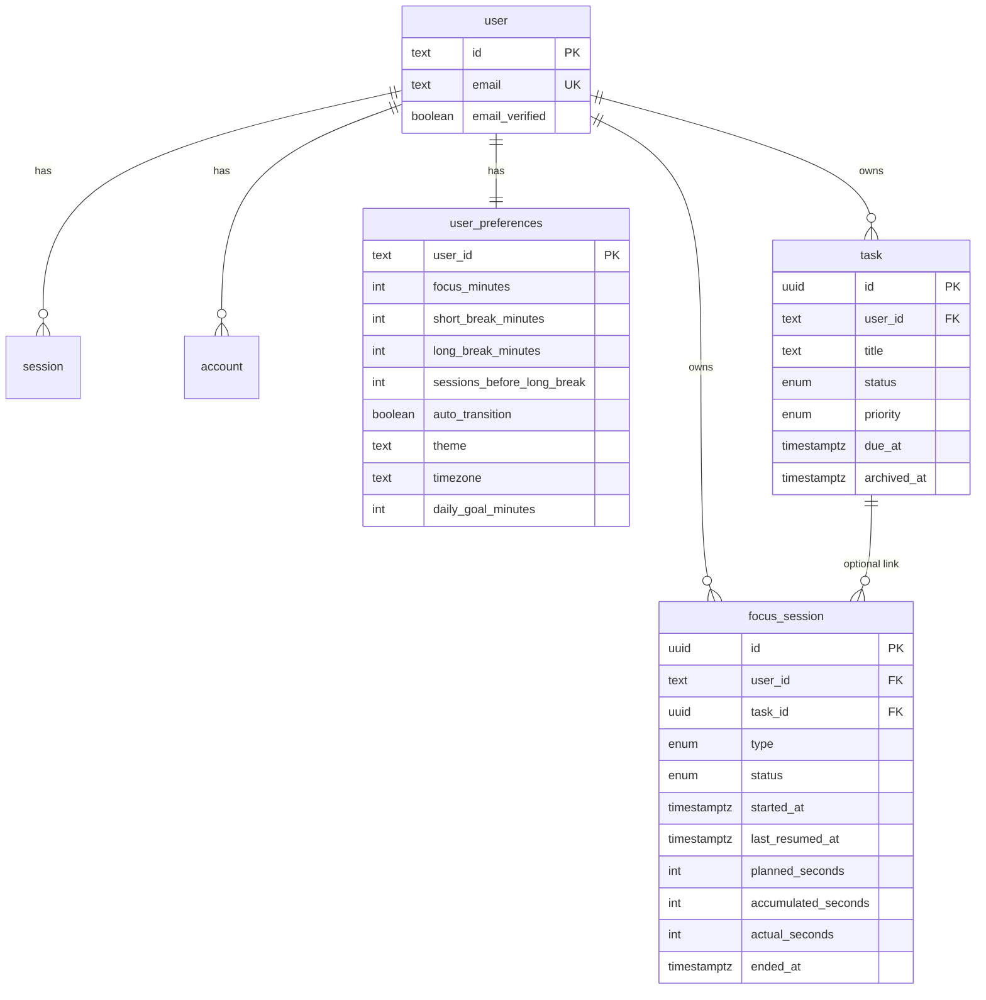
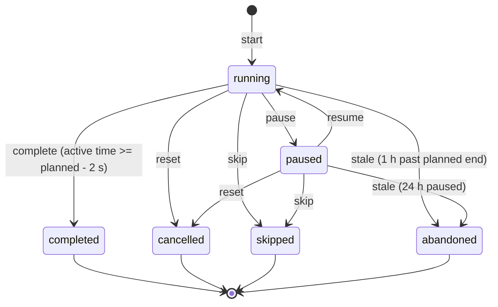

# FocusFlow

A calm focus timer with tasks, session history and honest statistics. Built with Next.js 16, PostgreSQL, Drizzle ORM and Better Auth.

> **Status.** Everything marked ✅ below was run and verified locally (unit, integration and end-to-end tests, a production build, and manual browser checks). Items marked 🔑 need your own accounts or keys and have **not** been exercised against real services. See [Implementation status](#implementation-status) and [Known limitations](#14-known-limitations).

## Contents

1. [Overview](#1-overview) · 2. [Features](#2-features) · 3. [Technology stack](#3-technology-stack) · 4. [Architecture](#4-architecture) · 5. [Prerequisites](#5-prerequisites) · 6. [Installation](#6-installation) · 7. [Environment variables](#7-environment-variables) · 8. [Database and migrations](#8-database-and-migrations) · 9. [Local development](#9-local-development) · 10. [Testing](#10-testing) · 11. [Production build](#11-production-build) · 12. [Deployment](#12-deployment) · 13. [Security considerations](#13-security-considerations) · 14. [Known limitations](#14-known-limitations) · 15. [Future improvements](#15-future-improvements)

Reference: [Server operations](#server-operations-reference) · [Data model](#data-model) · [Timer state machine](#timer-state-machine) · [Design decisions](#design-decisions-and-trade-offs) · [Docs index](#documentation-index)

---

## 1. Overview

FocusFlow makes starting a focus session effortless and makes progress measurable. You choose a task, run a focus session, take breaks, and review honest numbers: only **completed** focus sessions count, breaks never inflate focus time, and days follow your own timezone.

Principles the code is built around:

- The timer is derived from **saved timestamps on the server**, never from counting ticks, so refreshes, background tabs, sleep and wrong device clocks cannot corrupt it.
- A session is completed **at most once** (row lock plus a database constraint that allows one live timer per user).
- Every private read and write is scoped to the signed-in user on the server.
- It works on phones, tablets and desktops, with a keyboard and with assistive technology.

## 2. Features

| Area                    | What you get                                                                                                                                                                                                                                                                                                  |
| ----------------------- | ------------------------------------------------------------------------------------------------------------------------------------------------------------------------------------------------------------------------------------------------------------------------------------------------------------- |
| Landing & legal         | Landing page with timer preview, features, how it works, accurate privacy/security statement; Privacy, Terms (drafts for the operator to review) and Support pages                                                                                                                                            |
| Accounts                | Register, email verification, optional **Continue with Google**, sign in/out, forgot/reset password, change name and password (signs out other devices), account deletion with password + typed confirmation + emailed link                                                                                                                      |
| Timer                   | Focus, short break, long break; start, pause, resume, reset, skip; configurable durations and long-break cycle; optional automatic next session; mute control; full-screen view; completion chime and browser notification (both optional); tab title countdown; screen-reader announcements on state changes |
| Tasks                   | Create, edit, complete/reopen, archive/restore, delete; priority and due date; filter by status and priority; paginated; per-task focus time; pick a task before a session                                                                                                                                     |
| History                 | Filter by date range, type, status and task; paginated; delete your own finished sessions                                                                                                                                                                                                                     |
| Analytics               | Focus time, sessions, average, completion rate, current and best streak, daily and weekly charts, most productive weekdays, focus time by task; ranges of 7/14/30/90 days; SQL aggregates in your timezone                                                                                                     |
| Settings                | Durations, sessions before long break, auto-transition, sound, browser notifications (permission requested only when you enable it), theme (light/dark/system), timezone, optional daily goal                                                                                                                  |
| Accessibility & quality | Semantic landmarks, skip link, visible focus, 44px touch targets, reduced-motion support, contrast-checked tokens, axe-core clean in light and dark                                                                                                                                                           |

### Implementation status

| Status                                | Items                                                                                                                                                                                                                                                                                                                                                                                                  |
| ------------------------------------- | ------------------------------------------------------------------------------------------------------------------------------------------------------------------------------------------------------------------------------------------------------------------------------------------------------------------------------------------------------------------------------------------------------ |
| ✅ Implemented and verified locally   | All features in the table above; database constraints and migrations (fresh-database run, re-run and drift check); startup environment validation; security headers and CSP on a production build; rate limiting; account deletion; cross-user isolation; concurrent completion safety                                                                                                                  |
| 🔑 Needs your external configuration  | **Google OAuth** (a Google Cloud OAuth client; the redirect, state/PKCE, error handling and account-linking guard are tested with dummy credentials, but a real Google sign-in was **never run**), **Resend** (email delivery: verification, reset, deletion), **Neon** (or another managed Postgres) with TLS, **Vercel** (or another Node host) with HTTPS and a real domain. The code paths exist and are tested with a local file outbox and a local Postgres, but **real email delivery, TLS to a managed database, Secure cookies on a real HTTPS origin and the hosted deployment were never tested** |
| 🧭 Documented, not built (see §15)    | Two-factor auth, social login, data export, change-email flow, offline/PWA mode, service-worker notifications                                                                                                                                                                                                                                                                                         |

## 3. Technology stack

| Concern       | Choice                                                                                                |
| ------------- | ----------------------------------------------------------------------------------------------------- |
| Framework     | Next.js 16.4 (App Router, Turbopack), React 19.3, TypeScript (strict)                                 |
| Styling       | Tailwind CSS 4 with design tokens in `src/app/globals.css`; Lucide icons; small hand-written UI parts; `CircleProgress` (vendored, `src/components/ui/circle-progress.tsx`) draws the timer ring |
| Forms         | React Hook Form + Zod (shared schemas in `src/validators`)                                            |
| Database      | PostgreSQL 17 via Drizzle ORM 0.45 and Drizzle Kit (SQL migrations in `src/db/migrations`)            |
| Auth          | Better Auth 1.7 (scrypt hashing, sessions, email verification, reset, CSRF/origin checks)             |
| Email         | Resend (behind `src/lib/email.ts`); dev transport prints to the server console                        |
| Tests         | Vitest, React Testing Library, Playwright (+ axe-core) against real Postgres                          |
| Package/tools | pnpm, ESLint, Prettier                                                                                |

`cacheComponents` is deliberately **off** (see [Design decisions](#design-decisions-and-trade-offs)). Next.js 16 differs from earlier versions; the project's `AGENTS.md` points contributors (and coding agents) to the bundled docs in `node_modules/next/dist/docs/`.

## 4. Architecture



```
src/
  app/            routes: (public) landing/legal, (auth) sign-in flows, (app) dashboard/tasks/history/analytics/settings, api/
  components/     timer/, tasks/, settings/, analytics/, forms/, ui/ (presentation and interaction only)
  domain/         pure logic with no I/O: timer state machine, dates/timezones, streaks, auto-advance
  server/         services (timer, tasks, history, analytics, preferences), session/authorization, action helper
  db/             schema (auth.ts, app.ts) and migrations
  lib/            env validation, db pool, auth config, email, logger, errors, safe redirect, notify (browser)
  validators/     Zod schemas for every untrusted input
  proxy.ts        per-request CSP nonce, no-store on private routes, optimistic auth redirect
  instrumentation.ts  validates environment at server start
scripts/seed.ts   development seed
tests/            unit, component and integration tests (Vitest)
e2e/              Playwright journeys, security, accessibility, mobile, header checks
docs/             design notes and audits
```

Rules the code follows: business logic lives in `src/domain` and `src/server`, not in components; database access is server-only (`server-only` import); every service takes the authenticated `userId` from the session, never from client input; every mutation validates with Zod and returns a typed `ActionResult`; unexpected errors are logged without bodies and shown generically.

## 5. Prerequisites

- Node.js 24 (developed on 24.18; Next 16 needs a current LTS or newer)
- pnpm 12 (`corepack enable` or `npm i -g pnpm`)
- Docker (for the local PostgreSQL) or any PostgreSQL 15+ you can reach
- Google Chrome (end-to-end tests use the installed Chrome; no browser download needed)

## 6. Installation

```bash
git clone https://github.com/Anuoluwa-samuel/Focus-Flow.git "Focus Flow"
cd "Focus Flow"
pnpm install --frozen-lockfile
cp .env.example .env.local
# put a real secret in it:
sed -i.bak "s|replace-with-a-long-random-string-of-32-chars-or-more|$(openssl rand -base64 32)|" .env.local && rm .env.local.bak
docker compose up -d        # PostgreSQL on localhost:54330
pnpm db:migrate
pnpm dev                    # http://localhost:3000
```

## 7. Environment variables

Validated by `src/lib/env.ts` (Zod) when the server starts (`src/instrumentation.ts`). A bad configuration stops the server from serving requests and logs the **names and reasons** of the problems, never the values. `next build` does not need them.

| Variable             | Required          | Description                                                                                                                                   |
| -------------------- | ----------------- | --------------------------------------------------------------------------------------------------------------------------------------------- |
| `DATABASE_URL`       | yes               | PostgreSQL connection string. Non-local hosts are connected with TLS and certificate verification. Use a pooled URL on serverless hosts      |
| `BETTER_AUTH_SECRET` | yes               | At least 32 random characters (`openssl rand -base64 32`). Signs sessions and tokens. Rotating it signs everyone out                          |
| `BETTER_AUTH_URL`    | yes               | The public origin, no trailing slash, e.g. `https://app.example.com`. **Must match the address in the browser bar** (origin checks, cookies) |
| `EMAIL_FROM`         | yes               | Sender, e.g. `FocusFlow <noreply@your-domain.com>`; must be on a domain verified with Resend in production                                   |
| `RESEND_API_KEY`     | production only   | Resend API key. If empty in development, emails are printed to the server console. **Required in production** (startup fails without it)      |
| `SUPPORT_EMAIL`      | no                | Shown on the public Support page                                                                                                              |
| `GOOGLE_CLIENT_ID` / `GOOGLE_CLIENT_SECRET` | no (both or neither) | Enables "Continue with Google". Setting only one stops startup. Redirect URI to register in Google: `{BETTER_AUTH_URL}/api/auth/callback/google` (see [docs/DEPLOYMENT.md](docs/DEPLOYMENT.md)) |
| `EMAIL_OUTBOX_FILE`  | tests only        | Appends emails to a file instead of sending. Ignored in production. Used by the Playwright setup                                             |

`.env.example` holds placeholders only. `.env*` files are git-ignored. Never commit real values.

## 8. Database and migrations

- Schema: `src/db/schema/auth.ts` (Better Auth's tables plus `rate_limit`) and `src/db/schema/app.ts` (preferences, tasks, focus sessions).
- Generate after changing the schema: `pnpm db:generate` and commit the new SQL file.
- Apply: `pnpm db:migrate`. It is idempotent (already-applied migrations are skipped).
- Consistency: `pnpm db:check` validates the migration history.
- **Production migrations are a deliberate manual or CI step, never part of `build` or app start.** Run against production with `DATABASE_URL='…' pnpm db:migrate` from a trusted machine or pipeline job, after taking a backup, before releasing code that needs the change. Prefer additive, backward-compatible migrations (add, backfill, then switch code, then drop later).
- Verified: all migrations apply to a brand-new database, a second run is a no-op, and the schema file matches the migration files (no drift).

## 9. Local development

```bash
pnpm dev            # dev server with hot reload
pnpm db:seed        # demo data: demo@focusflow.test / demo-password-123 (local database only; refuses to run elsewhere)
pnpm db:studio      # browse data (Drizzle Studio)
```

- **Emails in development** are printed in the terminal running `pnpm dev` (look for `--- DEV EMAIL`). Open the link in the message to verify an account or reset a password.
- Port conflicts: if 3000 is taken, run `pnpm dev -p 3100` **and** set `BETTER_AUTH_URL=http://localhost:3100` (use the same host name in the browser: `localhost` and `127.0.0.1` are different origins with separate cookies).
- Handy for manual timer testing: set Focus to 1 minute in Settings.

Quality commands:

| Command                                           | Purpose                                                      |
| ------------------------------------------------- | ------------------------------------------------------------ |
| `pnpm typecheck`                                  | generate route types and run `tsc`                           |
| `pnpm lint` / `pnpm format` / `pnpm format:check` | ESLint, Prettier                                             |
| `pnpm run ci`                                       | format check, typecheck, lint, unit/integration tests, build |
| `pnpm audit`                                      | dependency vulnerability audit (production dependencies)     |

## 10. Testing

```bash
docker compose up -d     # tests need Postgres
pnpm test                # Vitest: unit, component, integration (164 tests)
pnpm test:e2e            # Playwright (38 tests)
```

- **Unit/component** (`tests/unit`): timer state machine and calculations, date/timezone and DST boundaries, streaks, validators, safe redirects, notification and mute logic, the Timer component (start, keyboard type selection, network failure, single completion).
- **Integration** (`tests/integration`, real Postgres, database `focusflow_test` created automatically): timer service (transitions, idempotent completion, 10 simultaneous completions and starts, ownership, stale recovery), tasks (CRUD, ownership, focus time), preferences, analytics definitions and timezone bucketing, history filters/pagination/deletion, database constraints and cascades.
- **End to end** (`e2e`, database `focusflow_e2e`, dev server on port 3250 and a **production build** on 3251, using your installed Chrome): the full user journey, cross-user isolation, concurrent tabs, redirect safety, auth security (enumeration, CSRF, rate limits, body size, logout, reset, deletion), production security headers and cookie flags, axe-core WCAG 2.2 AA scans in light and dark, keyboard-only use, phone layout and touch targets.
- The end-to-end setup moves a running session's clock back in the database instead of waiting minutes. The dev server may print `Error: aborted` lines while tests close pages mid-request; they are harmless noise.
- Not covered by automated tests: real email delivery, real TLS, screen readers, sound output, browser notification prompts, browsers other than Chrome, and load.

## 11. Production build

```bash
pnpm build
pnpm start          # needs the environment variables in §7 (including RESEND_API_KEY)
```

Verified: `pnpm build` succeeds with **no** environment variables; `next start` with an invalid configuration refuses to serve and logs which variables are wrong without printing values; the production build passes the header, cookie and cache checks in `e2e/headers.spec.ts`. All pages render per request (no static shell) because the CSP nonce must be unique per request.

## 12. Deployment

A complete step-by-step guide (Neon, Resend, Vercel, migrations, least-privilege database roles, backups, rollback, post-deploy checks) is in **[docs/DEPLOYMENT.md](docs/DEPLOYMENT.md)**. Summary:

1. Create a managed PostgreSQL database (Neon) and copy its **pooled** connection string.
2. Create a Resend account, verify your sending domain, create an API key.
3. Run migrations once from a trusted machine: `DATABASE_URL='…' pnpm db:migrate`.
4. Import the repository into Vercel; set `DATABASE_URL`, `BETTER_AUTH_SECRET`, `BETTER_AUTH_URL` (your https origin), `EMAIL_FROM`, `RESEND_API_KEY`, optionally `SUPPORT_EMAIL`.
5. Deploy, then run the post-deploy checklist (register → verify email → sign in → run a session → reset password → delete test account).

There are no OAuth callbacks to configure (email and password only). The auth endpoints live at `{BETTER_AUTH_URL}/api/auth/*`.

## 13. Security considerations

Full details: [docs/THREAT-MODEL.md](docs/THREAT-MODEL.md) and [docs/SECURITY-AUDIT.md](docs/SECURITY-AUDIT.md).

- **Google sign-in**: Authorization-code flow with state and PKCE; the client secret stays on the server; Google must assert the email is verified before an existing account is linked; if that existing account never verified its email, its password login and sessions are discarded first (stops pre-registration takeover); provider tokens are encrypted at rest; any OAuth failure returns to the sign-in page with one generic message; Google-only accounts delete via an emailed link instead of a password.
- **Authentication**: Better Auth with scrypt password hashing; HttpOnly, SameSite=Lax cookies (Secure and `__Secure-` prefixed in production); 7-day sessions validated against the database on each request; sessions revoked on password reset and change; email verification required before sign-in.
- **Enumeration and abuse**: identical responses for unknown/known addresses on sign-up, sign-in and reset; Postgres-backed rate limits (sign-in 5/min, sign-up, reset and verification 5-10/hour, default 60/min); auth request bodies capped at 16 KB; name/email length limits.
- **Authorization**: `requireUser()` on every protected page and action; services take `userId` from the session and scope every query; foreign IDs behave like missing ones; database foreign keys and constraints back this up.
- **Input and output**: Zod validation on every input with bounded lengths; parameterised queries via Drizzle; the timezone literal used in SQL is validated against a strict character set and Intl; no raw HTML rendering; open-redirect protection.
- **Headers**: nonce-based CSP with `strict-dynamic`, HSTS, `nosniff`, frame denial, referrer and permissions policies; `no-store` on private routes and APIs.
- **Secrets**: only in environment variables; startup validation; no secret values in the client bundle (checked); logs redact passwords, tokens, emails and URLs.
- **Dependencies**: `pnpm audit` clean at the time of writing; keep updating regularly.

This is not a claim of complete security. It has not been independently audited.

## 14. Known limitations

- 🔑 Resend delivery, TLS to Neon, Secure cookies/HSTS on a real HTTPS domain and the Vercel deployment are **untested** until you configure and try them.
- A browser cannot prove attention. A running timer is trusted to have run because it was never paused; the server decides completion, abandons a timer more than 1 hour past its end or paused over 24 hours, and never credits it.
- Notifications and the chime depend on the browser: they may not fire if the device has fully suspended the page, and the chime plays only after you interacted with the page in that visit.
- Verification links are signed tokens valid for 24 hours (not single-use rows); reset tokens are single-use but stored unhashed in the `verification` table (Better Auth's design).
- Rate limits are per client IP and cover the auth endpoints only; Server Actions rely on authentication, Next.js's origin check and database constraints.
- `style-src-attr 'unsafe-inline'` is allowed (the timer ring and charts use inline `style` attributes).
- Best streak looks back about 3 years. Changing timezone re-buckets history on the next view.
- Google sign-in has never been exercised against real Google. Google-only accounts have no password (no password-change form) and cannot unlink Google. There is no email-change flow, no data export, no two-factor authentication and no offline mode.
- Tested in Chrome only. No load testing. No independent security review. Privacy and Terms pages are drafts for you to review.

## 15. Future improvements

Two-factor authentication or passkeys; more social providers and an unlink/"set a password" flow; change-email and data-export (GDPR-style) flows; hashed single-use verification rows; service-worker notifications and a PWA/offline mode; per-user rate limits for Server Actions and a security-event audit log; CSP violation reporting; weekly goals, task estimates and tags; a configurable chime; Playwright runs on more browsers and in CI; load and soak tests.

---

## Server operations reference

All are authenticated, validated with Zod, and return `{ ok: true, data } | { ok: false, code, message, fieldErrors? }`. Codes: `UNAUTHENTICATED`, `FORBIDDEN`, `NOT_FOUND`, `VALIDATION`, `CONFLICT`, `TOO_EARLY`, `RATE_LIMITED`, `INTERNAL`. Foreign IDs return `NOT_FOUND`.

**Server Actions** (`"use server"`)

| Action (file)                                                    | Input                                 | Notes                                                                                                    |
| ---------------------------------------------------------------- | ------------------------------------- | -------------------------------------------------------------------------------------------------------- |
| `startTimerAction` (`dashboard/actions.ts`)                      | `{ type, taskId? }`                   | Duration comes from your saved preferences, not the client. One live timer per user: `CONFLICT` otherwise |
| `pauseTimerAction`, `resumeTimerAction`                          | `{ sessionId }`                       | Illegal transition: `CONFLICT`. Pausing at/after the planned end completes instead                       |
| `completeTimerAction`                                            | `{ sessionId }`                       | Idempotent. Before the planned time: `TOO_EARLY`. Stale: session abandoned, not credited                  |
| `resetTimerAction`, `skipTimerAction`                            | `{ sessionId }`                       | Record partial time, never counted as completed                                                          |
| `createTaskAction`, `updateTaskAction` (`tasks/actions.ts`)      | title, description, priority, dueDate | Max 500 active tasks; strict schemas, no mass assignment                                                 |
| `setTaskDoneAction`, `setTaskArchivedAction`, `deleteTaskAction` | `{ id, done / archived }`, `{ id }`   | Delete keeps linked sessions in history                                                                  |
| `updatePreferencesAction` (`settings/actions.ts`)                | all preference fields                 | Server-enforced ranges, also enforced by database CHECK constraints                                      |
| `deleteSessionAction` (`history/actions.ts`)                     | `{ id }`                              | Finished sessions only; a live timer cannot be deleted                                                   |

**Route Handlers**

| Route         | Method    | Purpose                                                                                                                                                     |
| ------------- | --------- | ----------------------------------------------------------------------------------------------------------------------------------------------------------- |
| `/api/auth/*` | GET, POST | Better Auth: sign-up, sign-in, Google sign-in and callback (`/sign-in/social`, `/callback/google`), sign-out, verify email, request/perform password reset, change password, update user, delete user, session. Body limit 16 KB |
| `/api/timer`  | GET       | Current timer snapshot used to re-sync after tab focus or reconnect. `401` when signed out, always `no-store`                                                |

**Pages**: `/` `/login` `/register` `/forgot-password` `/reset-password` `/verify-email` `/privacy` `/terms` `/support` (public); `/dashboard` `/tasks` `/history` `/analytics` `/settings` (signed in).

## Data model



Why the important constraints exist:

| Constraint / index                                                                 | Why                                                                                                                                  |
| ---------------------------------------------------------------------------------- | ------------------------------------------------------------------------------------------------------------------------------------ |
| Partial unique index `focus_session(user_id) WHERE status IN ('running','paused')` | At most one live timer per user: concurrent "start" requests cannot create two; sessions never overlap, so nothing is double counted |
| `fs_terminal_has_end`, `fs_running_has_resume`, `fs_ended_after_start`             | A session is live **iff** it has no end time; running sessions always have a resume timestamp; time cannot run backwards             |
| `fs_planned_range` (60 s to 8 h), `fs_accumulated_nonneg`                          | Rejects impossible durations even if application validation is bypassed                                                              |
| Preference and task `CHECK` ranges/lengths                                         | Same bounds as the Zod schemas, enforced in the database                                                                             |
| `focus_session(user_id, started_at DESC)`                                          | History pages and analytics range scans                                                                                              |
| `focus_session(user_id, task_id)`, `task(user_id, status, archived_at, created_at)` | Per-task focus time and task listing                                                                                                |
| `ON DELETE CASCADE` from `user`                                                    | Deleting an account removes every row it owns (verified)                                                                             |
| `task_id ON DELETE SET NULL`                                                       | Deleting a task keeps its sessions in history                                                                                        |
| `rate_limit` table                                                                 | Rate-limit counters shared across serverless instances                                                                               |

## Timer state machine



Active time = `accumulated_seconds` + (server now − `last_resumed_at`) while running. Only completed **focus** sessions count toward focus time, streaks and the completion rate. Details, recovery matrix and limits: [docs/TIMER.md](docs/TIMER.md). Metric definitions: [docs/ANALYTICS.md](docs/ANALYTICS.md).

## Design decisions and trade-offs

| Decision                                                            | Why / trade-off                                                                                                                   |
| ------------------------------------------------------------------- | --------------------------------------------------------------------------------------------------------------------------------- |
| Timestamps on the server are the source of truth                    | Correct across refresh, sleep and wrong clocks. Cost: the client measures its clock skew against the server and resyncs on focus  |
| One DB row per run; writes only on state changes                    | No per-second writes or polling. Cost: abandoned timers are only noticed when something reads them (handled on every read/start)  |
| Row locks + partial unique index instead of an in-memory/Redis lock | Works on stateless serverless hosts with only Postgres                                                                            |
| Better Auth instead of custom auth                                  | Maintained, no hand-rolled crypto. Cost: its token storage model (see limitations)                                                |
| Postgres-backed rate limits                                         | Shared across instances with no extra service. Cost: a few extra queries on auth endpoints                                        |
| `cacheComponents` off; every page rendered per request              | The nonce-based CSP requires dynamic rendering, and it keeps private data out of prerendered output. Cost: no static shell/caching |
| Nonce CSP with `strict-dynamic`; `style-src-attr 'unsafe-inline'`   | Strong script protection; inline style attributes cannot carry nonces                                                             |
| Services take `userId` from the session, never from input           | Makes cross-user access structurally hard; ownership checks double as `NOT_FOUND` so IDs leak nothing                             |
| Date-only task due dates stored as UTC midnight                     | A due date never shifts with timezone. Cost: no due times                                                                         |
| Analytics in SQL, charts hand-drawn with CSS                        | No chart dependency, nothing computed in the browser, values repeated as text and tables for accessibility                        |
| Dev email outbox file for e2e (disabled in production)              | Lets real browser tests follow verification/reset links without an email provider                                                 |

## Where the build differs from the Phase 1 plan

The original plan is kept in [docs/PHASE-1-PLAN.md](docs/PHASE-1-PLAN.md). Differences: local Postgres uses port **54330**; `cacheComponents` was turned off (CSP nonce); rate limiting uses Better Auth's database storage; verification and reset tokens follow the library's model rather than always-hashed single-use rows; the e2e suite uses a dev server plus a separate production build for header checks; the 1-hour abandon rule for overdue running timers was added.

## Documentation index

| File                                             | Contents                                                 |
| ------------------------------------------------ | -------------------------------------------------------- |
| [docs/DEPLOYMENT.md](docs/DEPLOYMENT.md)         | Neon, Resend, Vercel, migrations, roles, backups, checks |
| [docs/TIMER.md](docs/TIMER.md)                   | Timer engine, rules, recovery matrix                     |
| [docs/ANALYTICS.md](docs/ANALYTICS.md)           | Metric definitions                                       |
| [docs/THREAT-MODEL.md](docs/THREAT-MODEL.md)     | Assets, attackers, surfaces, mitigations                 |
| [docs/SECURITY-AUDIT.md](docs/SECURITY-AUDIT.md) | Phase 7 results, fixed findings, open items              |
| [docs/PHASE-1-PLAN.md](docs/PHASE-1-PLAN.md)     | Original architecture plan                               |
