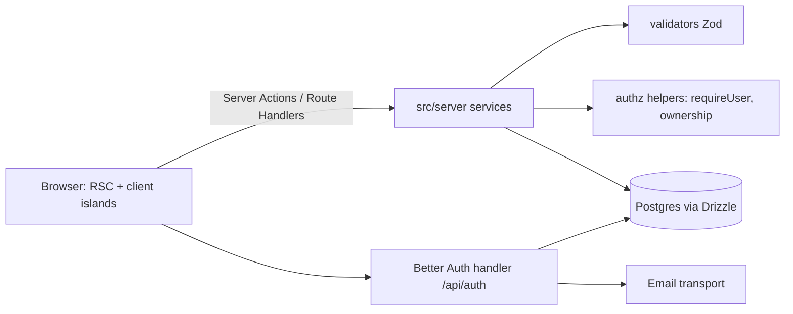
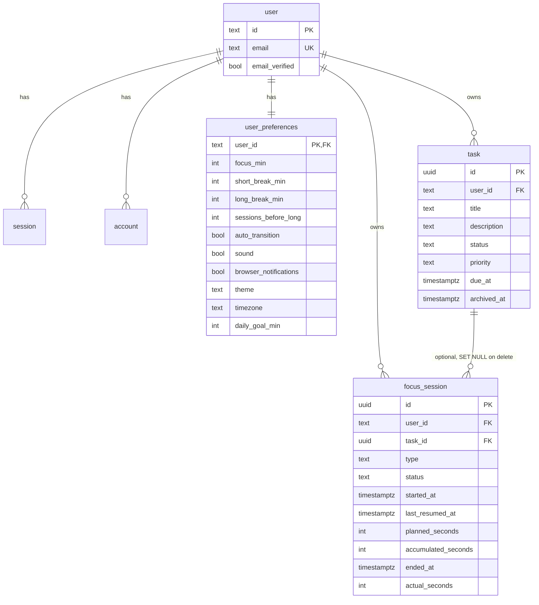
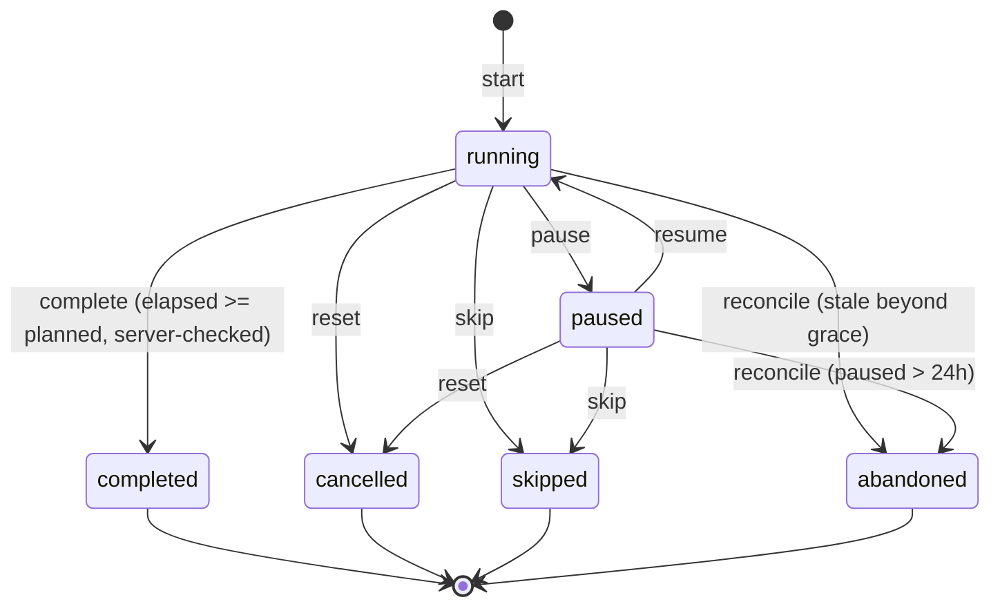

# FocusFlow: Phase 1 Plan (Discovery and Architecture)

## Discovery
- Repo `Anuoluwa-samuel/Focus-Flow` is **empty** (no commits). Nothing to preserve.
- Toolchain: Node 24.18, npm 11, pnpm 12.8, Docker 29.8 (for local Postgres). No local `psql`.
- Package manager: **pnpm** (lockfile committed).
- Verified current versions: Next 16.4.3, Better Auth 1.7.12, Drizzle ORM 0.45.4, Tailwind 4.3.3.
- Next 16 differs from older versions; docs in `node_modules/next/dist/docs/` get read right after scaffolding, before any code.

## Stack decisions
| Concern | Choice | Why |
|---|---|---|
| Framework | Next.js 16 App Router, React, strict TS | Required |
| Auth | Better Auth (Drizzle adapter) | Maintained, built-in scrypt hashing, email verification, reset, session revocation, CSRF/origin checks, rate limiting. No custom crypto. |
| DB | PostgreSQL + Drizzle ORM/Kit | Required. Local: Docker. Prod: Neon (or Supabase) |
| Email | Resend (behind a small `sendEmail` interface; console transport in dev) | Simple; can't be verified without an API key |
| Rate limiting | Better Auth limiter for auth; Postgres-backed limiter for other endpoints | Serverless-safe, no in-memory state |
| Validation | Zod shared schemas | |
| Tests | Vitest + RTL + Playwright; integration tests against Dockerised Postgres | |

## Architecture

Layout: `src/app` (routes), `src/components`, `src/lib` (db, auth, env, logger, rate-limit), `src/server` (task, timer, analytics, preferences services), `src/db` (schema, migrations), `src/validators`, `src/domain/timer` (pure state machine, no I/O), `tests/`.
Rules: pure domain logic in `src/domain`; services own transactions and ownership checks; components never touch the DB.

## Data model

Key constraints and indexes:
- **One live timer per user**: partial unique index on `focus_session(user_id) WHERE status IN ('running','paused')`. Prevents double-start races.
- **Idempotent completion**: completion is a conditional `UPDATE ... WHERE id=? AND user_id=? AND status IN ('running','paused')`; a second call finds the row already terminal and returns the stored result. Row lock (`FOR UPDATE`) inside a transaction.
- CHECKs: `planned_seconds BETWEEN 60 AND 28800`, `actual_seconds <= planned_seconds + tolerance`, status/type enums, `ended_at >= started_at`.
- Index `(user_id, started_at DESC)` for history and analytics; `(user_id, task_id)` for per-task time; `(user_id, status, due_at)` on tasks.
- Deletes: user delete cascades to all owned rows; task delete sets `focus_session.task_id` NULL so history survives.
- Task ownership: service queries always filter by `user_id`; a session's `task_id` is validated to belong to the same user.

## Timer state machine

"Idle" is the absence of a live row. Terminal states reject every transition.
- Active time = `accumulated_seconds` + (now − `last_resumed_at`) while running. Pause adds the running slice to the accumulator.
- **Server clock is authoritative.** The client gets `serverNow` with each response and keeps an offset, so a wrong device clock only affects display.
- **Completion rule**: server computes elapsed itself; completes only if active time ≥ planned − 2s tolerance. Otherwise 409 (client keeps showing the timer).
- Skipped/cancelled/abandoned focus sessions record their actual seconds but are excluded from "completed focus time". Breaks never count toward focus stats.
- **Abandoned**: a running session whose elapsed exceeds planned + grace (e.g. device slept, tab closed) is completed at `started+active` capped to planned, *only if* the server saw continuous running state; since the server only stores timestamps, a running session past its planned end is completed with `ended_at = projected end`, `actual = planned`. A paused session idle over 24h becomes abandoned with credit of its accumulated seconds, not counted as completed. (Documented limitation: a running timer is trusted to have run because the user never paused it.)
- Midnight/timezone: sessions are stored in UTC and bucketed by the user's timezone at query time, attributed to the day of `started_at`.
- Only state changes write to the DB (never per second); the client uses one `setInterval`/rAF to render and re-syncs on `visibilitychange`.

## Security plan
- Better Auth: scrypt hashes, HttpOnly + SameSite=Lax cookies, `Secure` in production, session rotation on login, revoke other sessions on password change/reset, hashed single-use short-lived verification/reset tokens, uniform responses for sign-up/reset to avoid account enumeration, trusted-origin check for CSRF.
- Every service function takes the authenticated `userId` from `requireUser()` (checked server-side, including in `proxy`/middleware only as a convenience, never as the sole gate).
- Zod on every input; bounded lengths; explicit column allow-lists (no mass assignment); safe redirect helper (relative paths only).
- Security headers and a nonce-based CSP, `Cache-Control: no-store` on authenticated responses, request size limits, Postgres-backed rate limiting.
- Logging: structured, with redaction of tokens/passwords/emails.
- Threat model (assets: credentials, sessions, tasks/history; attackers: anonymous, other authenticated user, token thief; surfaces: auth endpoints, IDs in actions, completion endpoint, redirect params) will be written to `docs/THREAT-MODEL.md` in Phase 2 and revised in Phase 7.

## Feature checklist
Landing; auth (register, verify, login, logout, reset, settings, delete account); dashboard; timer engine; sessions persistence; tasks; history (filters, pagination, delete); analytics (SQL aggregates, streaks); preferences; sound and notifications; a11y and responsive; light/dark tokens; tests; docs; deployment.

## Roadmap
1. **P2 Foundation**: scaffold, tokens, env validation, Docker Postgres, Drizzle schema + migration, Better Auth, error/validation patterns.
2. **P3 Timer**: pure domain + tests, service + idempotent completion, UI, recovery.
3. **P4 Tasks and preferences**.
4. **P5 History and analytics**.
5. **P6 Visual refinement, sound/notifications, a11y**.
6. **P7 Security and E2E**.
7. **P8 Production readiness and README**.

## External dependencies I cannot verify here
Resend delivery, Neon/Vercel deployment, and production cookie behaviour need your accounts/keys. I'll build the integration points and mark them "requires external configuration" in the README.
